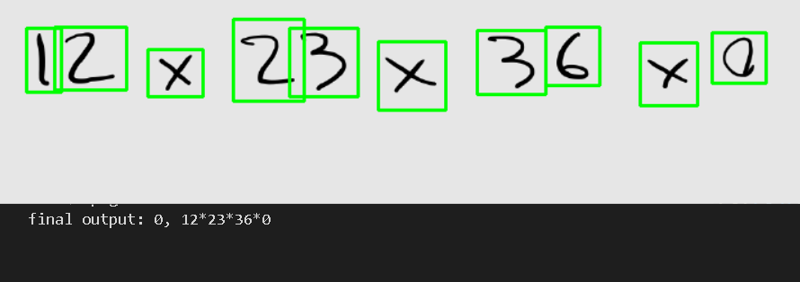

# Math Equation OCR

Recognize symbols in a one-line arithmetic expression and evaluate it. Includes a separate handwritten/printed classifier and the original image datasets.

## Competition

This project was developed for the [UT AI Hackathon](https://quera.org/events/ut-ai-0312). Our team qualified through the first stage and finished **5th out of 20 teams** in the second stage.

## Setup

Python 3.11 or 3.12:

```powershell
python -m venv .venv
.venv\Scripts\Activate.ps1
python -m pip install "torch>=2.6,<3" --index-url https://download.pytorch.org/whl/cpu
python -m pip install -r requirements.txt
```

For CUDA, use the installation command from [PyTorch](https://pytorch.org/get-started/locally/).

## Train and recognize

No trained weights are bundled. Train the symbol classifier first:

```console
python train.py symbols --epochs 5
python math_equation.py test/10.png --preview reports/10.png
```

Training saves the best validation model to `models/ocr_model.pth`, including the class mapping. Inference uses that same path. Use `--handwritten` for the lower component-area threshold on handwritten equations.

Inspect segmentation without training:

```console
python math_equation.py test/10.png --segment-only --preview reports/segments.png
```

The optional classifier uses `train_info.csv` and saves `models/handwriting_model.pth`:

```console
python train.py handwriting --epochs 20
```

Use both trained models to classify and recognize a folder:

```console
python predict.py test --handwriting-checkpoint models/handwriting_model.pth --output reports/predictions.csv
```

Each row includes its filename, predicted type, expression, answer and any evaluation error. Existing output files are refused. Without the handwriting checkpoint, use `--handwritten` to set the segmentation threshold manually. Both training commands use CPU by default; `--device cuda` selects CUDA.

## Data and limitations

- `train_ocr/`: 220 symbol crops in 16 class folders.
- `train/` and `train_info.csv`: 814 equations with printed/handwritten labels and answers.
- `test/`: 312 equation images. `submission.csv` is the original result file.
- `math_equation.ipynb` and `hand_writen_detection.ipynb`: training and prediction examples.

Training splits original images by class with a fixed seed, then augments only training images in memory. Generated weights and previews are ignored by Git. Commands do not overwrite `submission.csv`.

Segmentation assumes separated symbols arranged left to right. Touching handwriting, fractions and multiline equations are not supported. The small symbol dataset needs further training and evaluation; no recognition accuracy is claimed. Invalid expressions produce an error and a null answer.

Original example:



## Checks

```console
python -m pip install -r requirements-dev.txt
python -m unittest discover -s tests -v
python train.py symbols --epochs 1 --limit 32 --output models/smoke_ocr.pth
```

The limited run checks training and saving; its accuracy is not a benchmark. Notebook training cells are disabled by default.
